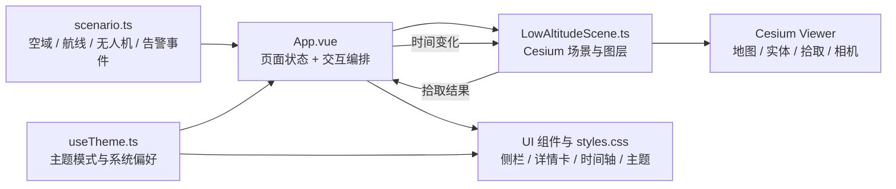

# 低空天穹 · 系统架构与代码导读

这份文档面向“边做边学”的本科课程设计场景：先解释系统怎么跑起来，再逐个说明文件夹和文件负责什么，最后给出扩展路线（主题、底图、3D 建筑、无人机模型、后端）。

---

## 1. 系统定位

这是一个**低空空域管控动态电子地图 MVP**：

- 用 CesiumJS 渲染三维地图、空域体、无人机和航线；
- 用 Vue 3 组织界面、状态和交互；
- 用前端模拟数据驱动“实时态势 + 时间回放 + 告警”；
- 用 CSS 设计令牌实现浅色 / 深色 / 跟随系统三种主题；
- 采用“地图优先”布局：一个可收起侧栏 + 按需出现的详情卡；
- 空域名称不常驻地图，统一放在侧栏和详情卡里，避免标签压图；
- 当前没有后端，所有数据在浏览器里计算，适合课程演示和后续扩展。

技术栈：

| 层 | 选型 | 说明 |
|---|---|---|
| 框架 | Vue 3 + TypeScript | Composition API，单页应用 |
| 构建 | Vite | 开发服务器、生产构建 |
| 地图 | CesiumJS | 三维地球、影像、实体、拾取、相机 |
| 样式 | 原生 CSS | CSS 变量 + 媒体查询，不引入 UI 组件库 |
| 图标 | 手写 SVG | `Icon.vue`，避免额外依赖 |
| 数据 | TypeScript 模拟数据 | 空域、航线、无人机、告警 |
| 主题 | `useTheme.ts` | localStorage + `prefers-color-scheme` |

---

## 2. 总体架构



数据流可以概括为：

```text
scenario.ts（静态数据 + 运动学函数）
        ↓
App.vue（simTime / 选中对象 / 图层开关 / 主题）
        ↓
LowAltitudeScene.update(time, alerts)
        ↓
Cesium Entity 属性更新（位置、颜色、标签、告警高亮）
```

地图拾取是反向的：

```text
用户点击地图
  → LowAltitudeScene 拾取 Entity
  → onSelect(selection)
  → App.vue 更新 selected / 详情卡
```

---

## 3. 启动流程

```text
index.html
  → 先执行内联主题脚本（避免刷新时闪白/闪黑）
  → main.ts 创建 Vue 应用
  → App.vue 挂载
  → new LowAltitudeScene(mapEl)
  → scene.init()
       ├─ 创建 Cesium Viewer
       ├─ 加载 Esri 底图
       ├─ 构建空域体、航线、无人机、设施、城市标签
       ├─ 绑定鼠标拾取和相机事件
       └─ 设置初始视角
  → setTime(INITIAL_TIME)
  → startLoop() 启动 requestAnimationFrame 模拟循环
```

`requestAnimationFrame` 循环只更新数据和时间轴；Cesium 使用 `requestRenderMode`，没有变化时不持续重绘，减少 GPU 占用。

---

## 4. 目录与文件职责

```text
low-altitude-mvp/
├─ index.html                  # HTML 入口；内联主题脚本；挂载点
├─ package.json                # 依赖与脚本
├─ vite.config.ts              # Vite 配置
├─ tsconfig.json               # TypeScript 配置
├─ README.md                   # 使用说明、功能、运行方式
├─ ARCHITECTURE.md             # 本文档：架构与代码导读
├─ scripts/
│  └─ copy-cesium.mjs          # 安装后把 Cesium 静态资源复制到 public/cesium
├─ public/
│  ├─ cesium/                  # Cesium 静态资源（npm install 生成，git 忽略）
│  ├─ favicon.svg              # 站点图标
│  └─ models/                  # 预留：无人机 glTF / 3D Tiles 模型
├─ docs/
│  ├─ preview-light.png         # README 截图
│  ├─ preview-dark.png
│  ├─ preview-detail.png
│  ├─ preview-layers.png
│  └─ preview-design.png
└─ src/
   ├─ main.ts                  # 创建 Vue 应用，挂载 App
   ├─ App.vue                  # 页面布局、状态、交互、时间轴、主题切换
   ├─ styles.css               # 设计令牌、明暗主题、所有组件样式
   ├─ env.d.ts                 # Vite / Vue 类型声明
   ├─ components/
   │  └─ Icon.vue              # 手写 SVG 图标组件
   ├─ composables/
   │  └─ useTheme.ts           # 浅色 / 深色 / 跟随系统
   ├─ data/
   │  └─ scenario.ts           # 空域、航线、无人机、告警规则与事件
   └─ cesium/
      └─ LowAltitudeScene.ts   # Cesium 场景、图层、拾取、相机、底图
```

### 4.1 `src/App.vue`

页面级“总控”，负责：

- 页面结构：顶栏、可收起侧栏、按需出现的详情卡、底栏时间轴、底图设计弹窗；
- 状态：`simTime`、`isPlaying`、`speed`、`selected`、`sidebarTab`、`sidebarOpen`、`layerState`、`layersOpen`；
- 交互：侧栏页签、播放/暂停、拖动时间轴、搜索、定位、跟随、2D/3D、图层弹层、底图切换、主题切换、侧栏收起；
- 与 Cesium 的连接：调用 `scene.update()`、`scene.select()`、`scene.focus()`、`scene.setLayerVisible()`；
- 计算派生数据：`selectedDronePos`、`activeAlerts`、`targetRows`、`alertListAll`。

学习建议：先看 `<script setup>` 里的状态和函数，再看 `<template>` 中它们如何被使用。

### 4.2 `src/cesium/LowAltitudeScene.ts`

Cesium 场景封装，负责：

- `init()`：创建 Viewer、配置场景、加载底图、构建所有图层；
- `buildAirspaces()`：空域体（Polygon + 顶/底/竖边）；
- `buildRoutes()`：航线虚线；
- `buildDrones()`：无人机 Billboard；
- `buildFacilities()`：运行管理中心、起降点图标；
- `update(time, alerts)`：根据模拟时间更新无人机位置、朝向、告警颜色、尾迹；
- `select()` / `focus()` / `follow()`：选中、定位、跟随；
- `resetView()`：复位默认视角；
- `setBasemap()`：暗色 / 浅色 / 卫星；
- `setLayerVisible()`：图层开关；
- `destroy()`：销毁 Viewer、事件和监听器。

关键类型：

```ts
type Selection = { kind: 'drone' | 'airspace'; id: string } | null;
type BasemapStyle = 'dark' | 'light' | 'satellite';
type CameraInfo = { lon: number; lat: number; height: number; heading: number };
```

### 4.3 `src/data/scenario.ts`

“数据 + 规则”层，不依赖 Vue 和 Cesium：

- `AIRSPACES`：空域数组，包含多边形、高度范围、类型、颜色、管理单位；
- `DRONES`：无人机数组，包含航线、速度、任务、颜色、机型；
- `positionAt(drone, time)`：按时间在折线航线上插值，返回经纬度、高度、航向、进度；
- `buildAlertEvents()`：按 1 秒采样，生成进入禁飞区、超出限高等告警事件；
- `SIM_DURATION`、`BASE_TIME`、`INITIAL_TIME`：演示时间配置；
- `AIRSPACE_META`、`DRONE_KIND_META`：界面展示用的枚举元数据。

### 4.4 `src/composables/useTheme.ts`

主题单例：

- `mode`：`light | dark | system`，首次打开默认跟随系统；
- `resolvedTheme`：系统模式下根据 `prefers-color-scheme` 解析；
- `setMode()`：切换并持久化到 `localStorage`；
- 监听系统主题变化；
- 把结果写入 `<html data-theme="...">`，CSS 通过变量切换。

### 4.5 `src/styles.css`

样式分为：

1. **设计令牌**：`:root` / `[data-theme='dark']` 中的颜色、圆角、阴影、字体；
2. **基础样式**：`body`、按钮、输入框、Cesium 覆盖；
3. **布局**：顶栏、侧栏、地图工具条、详情卡、底栏时间轴；
4. **组件**：侧栏页签、空域/目标/告警列表、详情卡、图层弹层、底图菜单、设计弹窗；
5. **响应式**：1440 / 1180 / 900 / 800 高度；
6. **动画**：侧栏、Toast、主题过渡；`prefers-reduced-motion` 降级。

做主题时优先改 CSS 变量，不要在组件里写死颜色。

### 4.6 `src/components/Icon.vue`

一个简单的 SVG 图标组件：

```vue
<Icon name="drone" :size="18" />
```

图标路径集中维护，新增图标时在 `icons` 对象里加一项即可。

### 4.7 `scripts/copy-cesium.mjs`

Cesium 的 `Assets`、`Workers`、`Widgets`、`ThirdParty` 不能直接被 Vite 打包，需要在 `npm install` 后复制到 `public/cesium/`。这个脚本由 `postinstall` 自动执行。

---

## 5. 关键数据模型

### 空域

```ts
interface Airspace {
  id: string;
  name: string;
  code: string;
  kind: 'control' | 'advisory' | 'no-fly' | 'temporary';
  polygon: number[][];   // [[lon, lat], ...]
  minAlt: number;
  maxAlt: number;
  color: string;
  status: string;
  authority: string;
  description: string;
}
```

### 无人机

```ts
interface Drone {
  id: string;
  callsign: string;
  model: string;
  operator: string;
  kind: 'logistics' | 'inspection' | 'security' | 'emergency';
  color: string;
  speed: number;
  route: Array<{ lon: number; lat: number; alt: number }>;
  plan: string;
  phase: number;
}
```

### 告警

```ts
interface AlertEvent {
  id: string;
  droneId: string;
  droneCallsign: string;
  airspaceId: string;
  airspaceName: string;
  level: 'critical' | 'warning';
  start: number;
  end: number;
  title: string;
  message: string;
}
```

---

## 6. 模拟与告警

`positionAt()` 的实现思路：

1. 根据速度和时间计算已经飞过的距离；
2. 在折线航线上逐段累加长度，找到当前所在段；
3. 在当前段内做线性插值；
4. 用前后点计算航向角；
5. 返回 `lon / lat / alt / heading / progress`。

告警事件在页面加载时预计算：

```text
每 1 秒采样一次所有无人机
  → 判断是否在禁飞区多边形内
  → 判断高度是否超过空域上限
  → 记录连续告警区间
  → 合并成 AlertEvent
```

这样做的好处是：时间轴回放和告警列表使用同一份事件，不会出现“列表里有、回放时没有”的不一致。

---

## 7. 主题系统

HTML：

```html
<html data-theme="light">
```

CSS：

```css
:root,
html[data-theme='light'] {
  --bg: #eef2f7;
  --surface: rgba(255, 255, 255, 0.88);
  --text: #111827;
  --accent: #2563eb;
}

html[data-theme='dark'] {
  --bg: #080c14;
  --surface: rgba(15, 23, 42, 0.82);
  --text: #f1f5f9;
  --accent: #60a5fa;
}
```

主题切换流程：

```text
点击浅色/深色/系统
  → useTheme.setMode()
  → resolvedTheme 变化
  → document.documentElement.dataset.theme 更新
  → CSS 变量切换
  → App.vue 监听 resolvedTheme，切换 Esri 底图
```

`index.html` 里的内联脚本会在 CSS 加载前先设置一次 `data-theme`，避免刷新时闪烁。

---

## 8. 如何扩展

### 8.1 新增一个空域

在 `scenario.ts` 的 `AIRSPACES` 中追加：

```ts
{
  id: 'AS-005',
  name: '新增空域',
  code: 'AS-005',
  kind: 'advisory',
  polygon: [
    [113.90, 22.50],
    [113.92, 22.50],
    [113.92, 22.52],
    [113.90, 22.52]
  ],
  minAlt: 0,
  maxAlt: 120,
  color: '#2BB6A8',
  status: '运行中',
  authority: '低空运行管理中心',
  description: '新增空域说明'
}
```

界面列表、Cesium 图层会自动读取，不需要改 UI。

### 8.2 新增一架无人机

在 `DRONES` 中追加航线、速度、任务和颜色。注意：

- `route` 至少两个点；
- `phase` 控制初始进度（0–1）；
- 新目标会自动出现在左侧“目标”页签和地图上。

### 8.3 新增主题

1. 在 `useTheme.ts` 的 `ThemeMode` 中加类型；
2. 在 `styles.css` 增加 `html[data-theme='...']` 变量；
3. 在 `App.vue` 的主题切换里加按钮。

### 8.4 替换底图

当前 `LowAltitudeScene.setBasemap()` 使用 Esri：

```ts
new Cesium.UrlTemplateImageryProvider({
  url: 'https://server.arcgisonline.com/ArcGIS/rest/services/...'
});
```

后续替换为 Maputnik + TileServer GL 时，只需要改这里的 URL：

```ts
new Cesium.UrlTemplateImageryProvider({
  url: 'http://localhost:8080/styles/low-altitude/{z}/{x}/{y}.png'
});
```

### 8.5 接入 3D 建筑（3D Tiles）

在 `LowAltitudeScene` 中新增：

```ts
private async buildBuildings(): Promise<void> {
  if (!this.viewer) return;
  const tileset = await Cesium.Cesium3DTileset.fromUrl('/3dtiles/city/tileset.json');
  tileset.maximumScreenSpaceError = 16;
  this.viewer.scene.primitives.add(tileset);
}
```

建议：

- 只在近距离/重点区域加载，避免远景性能压力；
- 用 `Cesium3DTileStyle` 按建筑高度着色；
- 建筑模型可以先用白模，后续换倾斜摄影；
- 注意 3D Tiles 的坐标系和高度基准。

### 8.6 接入无人机 glTF 模型

当前无人机用 `Billboard` 绘制。等模型文件准备好（例如 `public/models/drone.glb`），把 `buildDrones()` 里的 `billboard` 换成 `model`：

```ts
model: {
  uri: '/models/drone.glb',
  minimumPixelSize: 28,
  maximumScale: 120,
  heightReference: Cesium.HeightReference.NONE
}
```

如果模型有朝向，可以配合：

```ts
orientation: new Cesium.VelocityOrientationProperty(position)
```

注意 glTF 模型的前向轴（通常是 +Z 或 +X），必要时在建模软件里旋转，或在 Cesium 里加 `orientation` 修正。

---

## 9. Git 工作流

当前仓库根目录是 `D:\低空经济`，项目在 `low-altitude-mvp/`。

常用命令：

```bash
git status
git add low-altitude-mvp
git commit -m "feat: redesign airspace console UI"
git log --oneline
```

建议的提交粒度：

- `feat:` 新功能；
- `fix:` 修复；
- `style:` 纯样式调整；
- `docs:` 文档；
- `refactor:` 重构但不改变行为。

不要提交：

- `node_modules/`
- `dist/`
- `public/cesium/`（安装时生成）
- 临时截图、日志、`.env`

---

## 10. 学习路线

如果顺着这个项目学，建议按下面顺序：

1. **Vue 基础**：`ref` / `computed` / `watch` / 模板绑定 / 事件；
2. **TypeScript 基础**：接口、联合类型、泛型、类型收窄；
3. **Cesium 基础**：Viewer、Entity、Cartesian3、Camera、ScreenSpaceEventHandler；
4. **地图数据**：经纬度、WGS84、多边形、高度；
5. **交互**：拾取、选中、定位、跟随、时间轴；
6. **样式**：CSS 变量、Grid/Flex、响应式、明暗主题；
7. **工程化**：Vite、构建、Git、静态资源处理；
8. **扩展**：3D Tiles、后端 API、WebSocket 实时数据。

---

## 11. 当前限制

- 没有后端，数据是前端模拟；
- 告警规则是简化版，只做点面判断和高度区间；
- 没有真实 ADS-B / Remote ID；
- 底图暂时用 Esri，正式项目需替换为已授权底图；
- 没有 3D 建筑模型；
- 无人机目前是 Billboard，不是 glTF；
- 时间轴是固定 7 分钟演示窗口，不是真实时间流。

这些限制不影响课程答辩，但写进报告里会更严谨。
