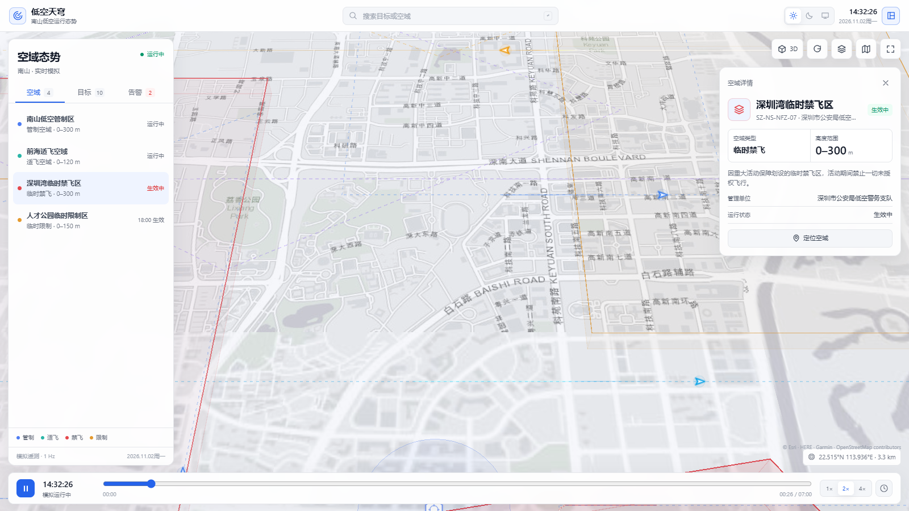
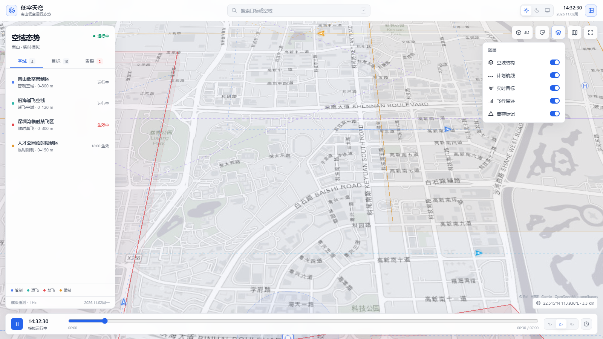

# 低空天穹 · 低空空域管控动态电子地图 MVP

面向本科课程设计/毕业设计的可运行 MVP：用 **Vue 3 + CesiumJS** 展示低空空域、模拟航空器、越界告警和时间回放。

界面采用“地图优先”的结构：一个顶栏、一个可收起侧栏、一个按需出现的详情卡，以及底部时间轴。空域名称不常驻地图，统一放在侧栏和详情卡里，避免标签压住地图。


> 架构说明、文件职责和学习路线见 [ARCHITECTURE.md](ARCHITECTURE.md)。

## 当前已实现

- Cesium 三维地球、2D/3D 切换、相机复位、全屏
- 滚轮缩放、拖拽平移、倾斜视角
- 4 个空域体：管制空域、适飞空域、临时禁飞区、临时限制区
- 10 架模拟无人机：物流、巡检、安防、应急四类任务
- 空域侵入、超出限高两类规则告警
- 左侧栏三个页签：空域 / 目标 / 告警
- 点击空域或目标，右侧出现浮动详情卡
- 空域名称不常驻地图；只有选中目标才显示目标标签
- 图层弹层：空域、航线、目标、尾迹、告警统一开关
- 底图切换：暗色 / 浅色 / 卫星
- 浅色 / 深色 / 跟随系统主题，自动切换 Cesium 底图
- 侧栏可收起，地图占满工作区
- 时间轴播放/暂停/倍速/拖动，使用原生 `range` 控件
- 搜索目标或空域，定位/跟随目标
- “底图设计规范”面板：色彩系统、图层层级、Maputnik 接入说明、3D 建筑预留
- 响应式布局，适配 1600×900、1366×768 及常见宽屏

## 设计原则

1. **地图优先**：不再用左右两块大面板夹住地图。
2. **一个侧栏**：空域、目标、告警放在同一个侧栏的三个页签里。
3. **详情按需出现**：只有选中对象时才出现详情卡，避免默认堆信息。
4. **地图少标签**：空域名称放在列表和详情卡；只有选中目标才显示目标标签。
5. **一个强调色**：蓝色作为唯一主强调色，红/黄只用于告警。
6. **原生控件**：滚动条、时间轴滑块使用浏览器原生样式。

## 技术栈

| 层 | 选型 |
|---|---|
| 前端框架 | Vue 3 + TypeScript + Vite |
| 三维地图 | CesiumJS |
| 状态 | Vue Composition API（MVP 阶段不引入 Pinia） |
| 主题 | CSS 变量 + `useTheme.ts` + `prefers-color-scheme` |
| 图标 | 手写 SVG 图标组件 |
| 数据 | 前端模拟数据 + 运动学插值 |
| 底图 | Esri 公共底图服务（演示用） |
| 构建 | Vite |

## 运行

要求 Node.js 22+。

```bash
cd low-altitude-mvp
npm install
npm run dev
```

打开：

```text
http://localhost:5173
```

其他命令：

```bash
npm run typecheck   # TypeScript 类型检查
npm run build       # 生产构建
npm run preview     # 预览构建结果
```

`npm install` 会把 Cesium 的 `Assets`、`Workers`、`Widgets`、`ThirdParty` 复制到 `public/cesium/`，无需手动处理。

## 界面预览

### 浅色主题


### 深色主题


### 空域详情



### 图层弹层



### 底图设计规范


## 交互说明

| 操作 | 效果 |
|---|---|
| 左侧“空域 / 目标 / 告警” | 切换侧栏列表 |
| 点击空域/目标 | 地图定位，右侧出现详情卡 |
| 详情卡右上角 × | 关闭详情卡 |
| 顶栏太阳/月亮/显示器 | 浅色 / 深色 / 跟随系统 |
| 顶栏右侧布局按钮 | 收起 / 展开侧栏 |
| 右上角图层按钮 | 开关空域、航线、目标、尾迹、告警 |
| 右上角底图按钮 | 切换底图、打开底图设计 |
| 右上角 3D / 2D | 切换三维态势 / 二维总览 |
| 鼠标滚轮 / 拖拽 | 缩放 / 平移地图 |
| 点击告警 | 时间跳转到告警窗口，定位目标 |
| 拖动时间轴 | 暂停模拟并回放该时刻 |
| `1× / 2× / 4×` | 调整模拟速度 |
| 底部时钟按钮 | 回到场景起点 |
| 搜索框输入 `UAV-001` 或空域名 | 定位目标/空域 |
| 详情卡“跟随” | 相机跟随目标 |

## 目录结构

```text
low-altitude-mvp/
├─ ARCHITECTURE.md                  # 架构、文件职责、学习路线
├─ src/
│  ├─ App.vue                      # 顶栏、侧栏、详情卡、时间轴、交互
│  ├─ cesium/
│  │  └─ LowAltitudeScene.ts       # Cesium 场景、空域、目标、告警渲染
│  ├─ components/
│  │  └─ Icon.vue                  # SVG 图标
│  ├─ composables/
│  │  └─ useTheme.ts               # 浅色 / 深色 / 跟随系统
│  ├─ data/
│  │  └─ scenario.ts               # 空域/航线/模拟/告警规则
│  ├─ styles.css                   # 设计令牌、明暗主题、组件样式
│  └─ main.ts
├─ public/
│  ├─ cesium/                      # Cesium 静态资源（安装时生成）
│  ├─ models/                      # 预留：无人机 glTF / 3D Tiles
│  └─ favicon.svg
├─ scripts/
│  └─ copy-cesium.mjs              # Cesium 资源复制脚本
├─ docs/                           # 预览截图
└─ index.html
```

## 数据和规则

- 空域、无人机航线、告警事件都在 `src/data/scenario.ts` 中维护；
- 无人机沿三维折线航线按速度循环飞行；
- 告警规则：
  - 进入临时禁飞区且高度在 0–300m：`NO_FLY_INTRUSION`
  - 在适飞空域内超过 120m：`ALTITUDE_DEVIATION`
  - 在临时限制区内超过 150m：`TEMP_RESTRICTION`
- 告警事件在页面加载时按 1 秒采样预计算，因此时间轴回放和告警列表能保持一致；
- 初始时间会自动定位到第一个严重告警窗口。

## MVP 阶段的取舍

- **没有后端**：模拟器、规则判断、数据都在浏览器里完成，启动简单；
- **没有真实 ADS-B/Remote ID**：使用模拟遥测，适合答辩演示；
- **底图暂时用 Esri 公共瓦片**：演示方便，但正式项目应替换为 Maputnik + TileServer GL 或本地离线瓦片；
- **告警规则是简化版**：只做点面判断 + 高度区间，不包含 4D 预测、间隔碰撞等；
- **没有 3D 城市模型**：用 2.5D 空域体和示意设施表达低空结构。

## 下一步

1. **底图真正接入 Maputnik**：
   - OpenMapTiles/MapTiler 矢量瓦片
   - Maputnik 编辑 `style.json`
   - TileServer GL 栅格化为 `/styles/{id}/{z}/{x}/{y}.png`
   - Cesium `UrlTemplateImageryProvider` 加载
2. **加一个轻量后端**：Node/Express + `ws` + SQLite，把模拟器和告警判定移到服务端；
3. **完善空域管理**：GeoJSON 导入、绘制、编辑、生效时间；
4. **增强回放**：轨迹分片加载、告警事件时间轴联动；
5. **3D Tiles 建筑模型**：重点区域白模/倾斜摄影 + `Cesium3DTileset` + 建筑高度分级/风格化；
6. **无人机 glTF 模型**：把 Billboard 替换为实际模型，并处理朝向、缩放和告警高亮。

## 底图版权

演示底图来自 Esri World Dark Gray / Light Gray / World Imagery 服务，页面内保留版权标识。正式发布或离线部署时，请替换为已授权/已审核的底图数据，并遵守地图审核、测绘资质和版权要求。
